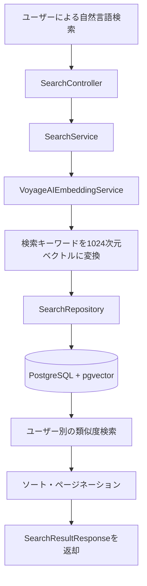

<div align="center">

# 📖 TADA

### AIを活用した感情日記・自然言語検索サービス

**覚えている文章を入力するだけで、意味が近い過去の日記を見つけられる検索機能**

<br>


<br><br>

[**プロジェクト全体**](https://github.com/OhSSangHoon/tada-was) ·
[**担当した検索機能のコード**](https://github.com/halloween96/tada-was_JR/tree/fix/search-cosine-distance/src/main/java/com/tada/tada/search) ·
[**検索機能のテストコード**](https://github.com/halloween96/tada-was_JR/tree/fix/search-cosine-distance/src/test/java/com/tada/tada/search)

</div>

---

## 📌 プロジェクト概要

**TADA**は、ユーザーが日記を記録し、AIを活用して過去の出来事を振り返ることができる日記サービスです。

私はチームプロジェクトで、**バックエンドの`search`機能**を担当しました。

過去の日記に書いた文章を正確に覚えていなくても、自然言語の検索キーワードをベクトルに変換し、**内容の意味が近い日記を検索できる機能**を実装しました。

> **担当範囲**
>
> 自然言語検索REST API・Voyage AIのEmbedding API連携・pgvectorによる類似度検索・ソート／ページネーション・Embeddingの非同期更新・単体テスト

---

## 🛠 技術スタック

| 区分 | 使用技術 |
| :--- | :--- |
| Language | Java 17 |
| Backend | Spring Boot, Spring Data JPA, Spring Security, Spring RestClient |
| Database | PostgreSQL, pgvector |
| AI | Voyage AI（`voyage-4`、1024次元Embedding） |
| Test | JUnit 5, Mockito |
| Collaboration | Git, GitHub |

---

## ✨ 主な機能

| 機能 | 内容 |
| :--- | :--- |
| 🔎 **自然言語による意味検索** | 検索キーワードをベクトル化し、意味的に類似した過去の日記を検索 |
| 🔐 **ユーザー別検索** | ログインユーザーが作成した日記のみを検索 |
| ↕️ **ソート・ページネーション** | 関連度順、新しい順、古い順での並び替えとページ単位の取得 |
| 🔄 **Embeddingの自動更新** | 日記の作成・編集後、イベントを利用して検索用ベクトルを非同期更新 |
| 🛡️ **エラー対応** | 検索キーワードのバリデーションおよび外部APIのHTTP 429レスポンスに対するリトライ処理 |
| 🧪 **単体テスト** | 検索結果の変換、ソート条件の分岐、エラー処理の検証 |

---

## 👨‍💻 担当業務と主な実装内容

### 01. Embeddingを活用した意味ベースの検索

- `VoyageAIEmbeddingService`を使用し、検索キーワードを**1024次元ベクトル**に変換
- `SearchRepository`でPostgreSQLのpgvectorが提供する**コサイン距離演算子`<=>`**を使用
- Embeddingが存在し、ステータスが`ACTIVE`の日記を対象に類似度検索を実行
- コサイン距離が`0.7`未満のデータを検索結果として抽出する条件を設定
- 検索キーワードと日記本文の単語が完全に一致しなくても、意味的に関連する日記を検索できるように実装

> **コサイン距離の基準**
>
> コサイン距離はベクトル間の差を表す値で、値が小さいほど意味的に類似していると判断します。
>
> `0.7`は検索結果を絞り込むための距離のしきい値であり、検索精度が70%であることを意味するものではありません。

### 02. ユーザー別検索APIと検索結果のソート

- `GET /api/search`のREST APIを実装
- Spring Securityの認証情報からユーザーUUIDを取得し、検索対象を制限
- ログインユーザー自身の日記のみを取得できるようにRepositoryの検索条件を設定
- `SearchResultResponse` DTOを利用して検索結果を返却
- `Pageable`を利用したページネーション処理
- `latest`、`oldest`、`relevance`のソート機能を提供

**対応するソート方式**

| ソートオプション | 説明 |
| :--- | :--- |
| `latest` | 新しい日記から表示 |
| `oldest` | 古い日記から表示 |
| `relevance` | 検索キーワードとの関連度が高い順に表示 |

### 03. 日記保存後のEmbedding非同期更新

- `DiaryEmbeddingEventListener`を利用して日記の作成・編集イベントを受信
- `@TransactionalEventListener`を活用し、トランザクションのコミット後にEmbedding処理を実行
- `@Async`を使用してEmbedding生成処理を非同期タスクとして分離
- 生成されたEmbeddingベクトルをデータベースに反映し、検索に利用

**処理の流れ**

1. ユーザーが日記を作成または編集
2. 日記保存のトランザクションが完了
3. Embedding更新イベントを処理
4. Voyage AIを利用して日記の内容をベクトル化
5. 生成されたベクトルをデータベースに保存
6. 以降の自然言語検索で検索対象として利用

### 04. 例外処理とテスト

- `null`、空文字列、空白のみの検索キーワードに対するバリデーション
- Voyage AI APIからHTTP 429レスポンスが返された場合、**2秒待機して最大1回リトライ**
- 既存の日記に不足しているEmbeddingデータを補完するため、`DiaryEmbeddingBackfillRunner`を実装
- `@Profile("!prod")`を利用し、本番環境以外でのみバックフィル処理を実行
- JUnit 5とMockitoを利用した`SearchService`の単体テストを作成
- 正常な検索処理、DTOへの変換、ソート条件の分岐、エラー発生時の処理を検証

---

## 🔁 検索処理の流れ



### 検索API

**Endpoint**

```http
GET /api/search?query=기분%20좋은%20날&page=0&size=3&sort=relevance
```

**リクエストパラメータ**

| パラメータ | 説明 | デフォルト値 |
| :--- | :--- | :--- |
| `query` | 自然言語の検索キーワード（必須） | なし |
| `page` | ページ番号 | `0` |
| `size` | 1ページあたりの取得件数 | `3` |
| `sort` | `latest` / `oldest` / `relevance` | `latest` |

---

## 📂 主なソースコード

<details>
<summary><b>検索機能の主要ソースファイルを表示</b></summary>

<br>

| ファイル | 役割 |
| :--- | :--- |
| `SearchController` | 検索リクエストと認証情報の処理 |
| `SearchService` | 検索キーワードの検証、サービスロジック、DTOへの変換 |
| `VoyageAIEmbeddingService` | Voyage AI Embedding APIとの連携 |
| `SearchRepository` | pgvectorによるコサイン距離検索 |
| `DiaryEmbeddingEventListener` | 日記の作成・編集後のEmbedding更新 |
| `DiaryEmbeddingBackfillRunner` | 開発環境における既存Embeddingデータの補完 |
| `SearchServiceTest` | 検索サービスの単体テスト |

<br>

**ソースコードへのリンク**

- [検索機能のソースコード一覧](https://github.com/halloween96/tada-was_JR/tree/fix/search-cosine-distance/src/main/java/com/tada/tada/search)
- [検索機能のテストコード](https://github.com/halloween96/tada-was_JR/tree/fix/search-cosine-distance/src/test/java/com/tada/tada/search)

</details>

---

## 💡 プロジェクトを通じて学んだこと

### ベクトルベースの検索機能の実装経験

単純な文字列比較ではなく、テキストEmbeddingとpgvectorを活用した意味ベースの検索機能を実装しました。

これにより、自然言語データをベクトルに変換し、データベース上で類似度を比較する検索処理の流れを経験しました。

### ユーザーデータへのアクセス範囲の制限

Spring Securityの認証情報とRepositoryの検索条件を連携させ、ログインユーザー自身のデータのみを検索できるように実装しました。

検索機能においても、ユーザーごとのデータアクセス範囲を適切に制限することの重要性を学びました。

### イベント駆動による非同期処理

日記の保存後に実行されるEmbedding生成処理を、イベント駆動の非同期処理として分離しました。

この経験を通じて、データの保存処理と追加処理の実行タイミングを分離する方法を学びました。

### 単体テストの作成

JUnit 5とMockitoを使用し、検索結果の変換処理、ソート条件、例外発生時の動作を検証しました。

外部APIやRepositoryへの依存をモックオブジェクトに置き換えることで、サービスロジックを独立してテストする経験を積みました。

### 今後の改善点

- 実際の検索事例に基づくコサイン距離のしきい値の調整
- 検索精度およびレスポンス時間の測定
- 外部Embedding APIの障害発生時における監視機能の強化

---

<div align="center">

</div>
